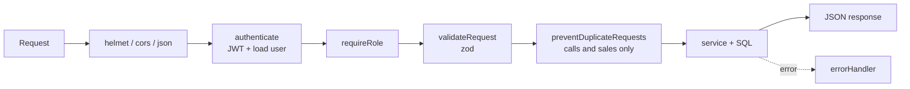
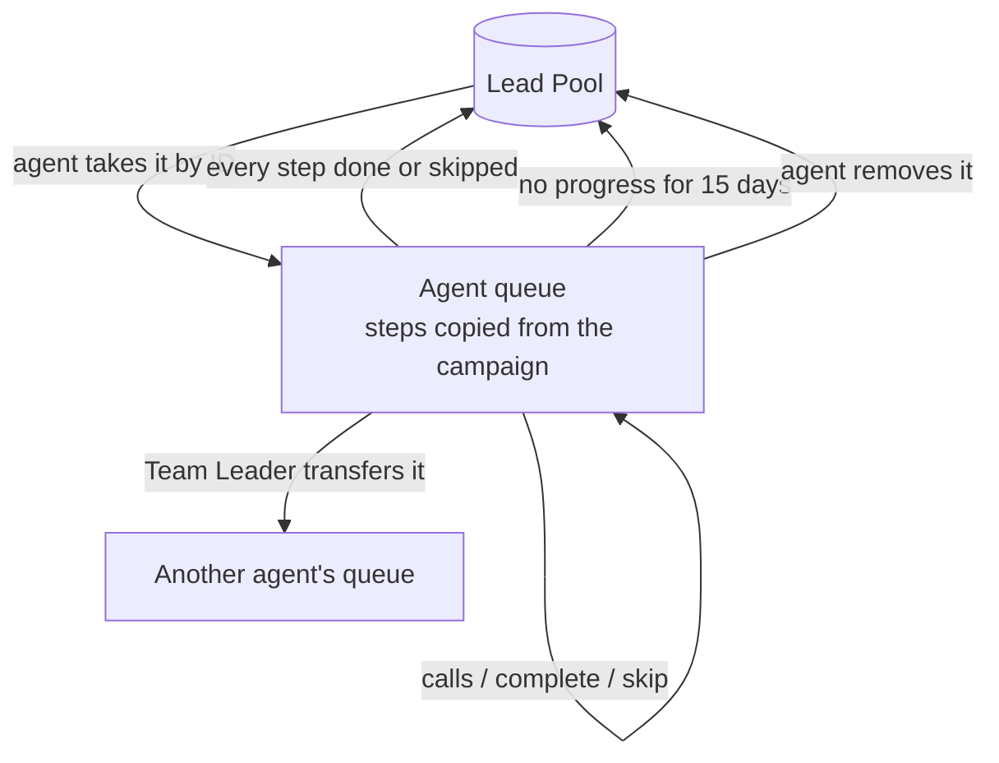

# Smart Telesales — Back End API

The REST API behind **Smart Telesales**, a CRM for telesales teams. It owns all the data and all the business rules:
who can see what, how leads move between the shared pool and agents, when a lead expires, and how sales are counted.
The [front end](../frontend/README.md) is only a client of this API.

> See the [project overview](../README.md) for the big picture.

| | |
|---|---|
| **Runtime** | Node.js + Express |
| **Database** | PostgreSQL (tested with Neon) |
| **Size** | 16 modules, about 70 routes, 17 tables |
| **API reference** | [https://smart-telesalesapis.vercel.app/](https://smart-telesalesapis.vercel.app/) |
| **Source code** | [https://github.com/Anas-hisham/smart-telesales](https://github.com/Anas-hisham/smart-telesales) |

---

## Table of contents

1. [Features](#1-features)
2. [Tech stack](#2-tech-stack)
3. [Getting started](#3-getting-started)
4. [Architecture](#4-architecture)
5. [Authentication and roles](#5-authentication-and-roles)
6. [The lead lifecycle](#6-the-lead-lifecycle)
7. [Safe multi-user actions](#7-safe-multi-user-actions)
8. [Background jobs](#8-background-jobs)
9. [API overview](#9-api-overview)
10. [Database](#10-database)
11. [Error format](#11-error-format)
12. [Project structure](#12-project-structure)

---

## 1. Features

- **Five roles** (Admin, Operation Manager, Team Leader, Agent, Quality), each with its own permissions and its own
  slice of the data.
- **Lead lifecycle**: a shared pool, agents taking leads, ordered touch-point workflows per campaign, call logging,
  meetings, and automatic return to the pool.
- **Dashboards and analytics**: daily progress against targets, lead-to-sale funnel, answer and reach rates,
  best calling hours, and call reasons, by campaign and agent.
- **Sales tracking** with monthly targets per agent, team and Operation Manager.
- **Internal communication**: team updates, tasks, tips from Quality, escalations, and notifications with menu badges.
- **Safe under concurrency**: row locks, transactions, idempotency keys and a login rate limiter.
- **Scheduled jobs** that enforce the 15-day lead rule and send meeting reminders.

---

## 2. Tech stack

| Technology | Used for |
|---|---|
| **Node.js + Express** | HTTP server and routing |
| **PostgreSQL** (`pg`) | Data, transactions, row locks, advisory locks |
| **zod** | Validation of every request body and query |
| **jsonwebtoken** | Access tokens (JWT) |
| **bcryptjs** | Password hashing |
| **helmet, cors** | Security headers and CORS |
| **dotenv** | Environment configuration |

---

## 3. Getting started

**Requirements:** Node.js 18+ and a PostgreSQL database (local, or a hosted one such as Neon).

### 3.1 Run

```bash
npm install
npm run migrate     # applies every sql/*.sql file once, in order
npm run dev         # or: npm start
```

(`npm run migrate` is the one documented inside `scripts/migrate.js`; the other commands assume the usual scripts in
`package.json`.)

Check that it is alive:

```bash
curl http://localhost:3000/health
# {"status":"ok"}
```

All API routes live under **`/api`**, for example `POST http://localhost:3000/api/auth/login`.

> The front end defaults to `/api/v1`. Set its `VITE_API_URL` to `http://localhost:3000/api`, or every request will
> return `404`.

### 3.2 First admin user

`scripts/seed.js` creates the first admin (and, with `--demo`, a small demo company). See
[Known gaps](#13-known-gaps): the script needs a small fix before it runs. Until then you can insert the first admin
with SQL (the `users` table needs a bcrypt password hash).

---

## 4. Architecture

Every module has the same two files:

- `<module>.routes.js` – URL, role check, validation, and a one-line call to the service.
- `<module>.service.js` – the business logic and the SQL.

Request pipeline:



Only `/auth/login` and `/auth/refresh` are public. Everything else needs a valid access token.

**Time rules:** all business dates use the **Africa/Cairo** time zone, and the week starts on **Saturday**.

---

## 5. Authentication and roles

### Tokens

- **Access token:** JWT, valid for **15 minutes**, sent as `Authorization: Bearer <token>`.
- **Refresh token:** random 48 bytes, valid for **30 days**, stored **hashed** (SHA-256) in the database.
- **Rotation:** every refresh deletes the old refresh token and issues a new pair, so a stolen token cannot be reused
  after the real user refreshes.
- **Logout:** with a refresh token it ends that device only; without one it ends every session of the person.
- **Login** compares the password with bcrypt even for unknown usernames, so the response time does not reveal
  whether a user exists. It is limited to **5 attempts per minute** per IP and username.
- The user is reloaded from the database on every request, so a deactivated account loses access immediately.

### Who can see what

The `visibleAgentIds` rule decides which agents' data a person can read:

| Role | Can see |
|---|---|
| Admin | Everyone |
| Agent | Only themselves |
| Team Leader | The agents of their team |
| Operation Manager | The agents of all the teams they manage |
| Quality | The agents they follow |

Dashboards, analytics, sales, leads and meetings are all filtered by this rule on the server, so the front end
cannot ask for data a role should not have.

---

## 6. The lead lifecycle



1. **Admin** loads leads into the pool (one by one, or by pasting/importing a list) and assigns a campaign.
2. An **agent** takes a lead by its exact ID. The lead's touch-point steps are copied from the campaign with due dates.
3. The agent works the steps: log calls, complete, skip or restore a step, stop or resume the lead.
4. The lead **returns to the pool** when its steps are finished, after **15 days without activity**, or when the agent
   removes it. An upcoming arranged meeting keeps a lead alive until the meeting is over.
5. **Cooldown:** after a lead leaves a queue, only the previous agent can take it again at once. Any other agent must
   wait **15 days**.
6. **Only Admin deletes leads.** Deleting a lead also deletes its sales and cancels its arranged meetings.
   A recorded sale does not keep a lead in the queue: the sale stays with the agent who made it.

---

## 7. Safe multi-user actions

Many people work on the same data at the same time. These mechanisms keep it consistent:

| Problem | Solution |
|---|---|
| Two agents take the same lead | The take runs in a **transaction** with `SELECT … FOR UPDATE` on the lead rows |
| A double click records a call or a sale twice | **Idempotency keys**: the same `Idempotency-Key` header from the same user on the same route returns the first answer (`Idempotent-Replayed: true`). A request that is still running returns `409 REQUEST_IN_PROGRESS` |
| A failed request blocks its key | Failed requests release their key; keys stuck in progress for 60 seconds are cleared |
| A multi-step write fails half way | All multi-step writes use one transaction, so they commit together or roll back together |
| Password guessing | Login limiter: 5 attempts per minute per IP and username |
| Several server instances run the jobs twice | Jobs are guarded by a PostgreSQL **advisory lock** (see below) |

Note: the login limiter keeps its counters in memory, so it is accurate for a single server instance.

---

## 8. Background jobs

A timer starts with the server (unless `RUN_JOBS=false`) and runs **every 30 seconds**. One run is one transaction,
guarded by `pg_try_advisory_xact_lock`, so two instances never run it at the same time. The jobs do not overlap.

| Job | What it does |
|---|---|
| **15-day rule** | A lead with no activity for 15 days returns to the pool and its agent gets a notification. A meeting in the last 15 days, or an upcoming one, counts as activity |
| **Finished workflows** | A lead whose every step is done or skipped returns to the pool |
| **Meeting reminders** | A notification to the participants **15 minutes before** an arranged meeting |
| **Clean-up** | About once an hour: delete idempotency keys older than 24 hours and expired refresh tokens |

The jobs read leads with `FOR UPDATE SKIP LOCKED`, so they never fight with an agent who is working on the same lead.

---

## 9. API overview

Base path: `/api`. The full request and response examples are in the [API reference](../docs/smart-telesales-apis.html).

| Area | Endpoints | Who |
|---|---|---|
| **Auth** | `POST /auth/login`, `POST /auth/refresh`, `POST /auth/logout`, `GET /auth/me` | Login and refresh are public |
| **Users** | `GET /users`, `POST /users`, `PATCH /users/:id`, `POST /users/:id/reset-password` | Create and edit: Admin |
| **Teams** | `GET /teams`, `GET /teams/:teamId/quality-choices`, `GET /agents/:agentId/quality-choices`, `PUT /agents/:agentId/team`, `PUT /teams/:teamId/manager`, `PUT /agents/:agentId/quality` | Changes: Admin |
| **Campaigns** (called *workflows*) | `GET /workflows`, `POST /workflows`, `PUT /workflows/:code`, `DELETE /workflows/:code` | Changes: Admin |
| **Admin leads** | `GET/POST /admin/leads`, `POST /admin/leads/import/preview`, `POST /admin/leads/import`, `POST /admin/leads/delete` | Admin |
| **Lead pool** | `POST /lead-pool/preview`, `POST /lead-pool/take` | Agent |
| **Leads** | `GET /leads`, `GET /leads/:id`, `GET /me/work-queue` | Scoped by role |
| **Lead actions** | `POST /leads/:id/touch-points/:order/{complete\|skip\|restore}`, `POST /leads/:id/calls`, `PATCH /leads/:id/calls/:logId`, `POST /leads/:id/{stop\|resume\|remove}` | Agent |
| | `POST /leads/:id/transfer` | Team Leader, OM |
| **Meetings** | `GET /meetings/options`, `GET/POST /meetings`, `PATCH /meetings/:id`, `POST /meetings/:id/reschedule` | Agent, TL, OM, Quality |
| **Tasks** | `GET/POST /tasks`, `GET /tasks/assignees`, `POST /tasks/seen`, `POST /tasks/:id/toggle` | Create: leaders |
| **Updates** | `GET/POST /updates`, `POST /updates/seen`, `POST /updates/:id/acknowledge` | Post: OM, TL |
| **Tips** | `GET/POST /tips`, `GET /tips/recipients`, `POST /tips/seen`, `POST /tips/:id/acknowledge` | Post: Quality. Acknowledge: Agent |
| **Sales** | `GET /sales/overview`, `GET /sales/agents/:agentId/details`, `POST /sales`, `DELETE /sales/:id` | Record and delete: Quality |
| **Escalations** | `GET/POST /escalations`, `GET /escalations/subjects`, `GET /escalations/recipients`, `POST /escalations/:id/{forward\|resolve}` | All roles |
| **Notifications** | `GET /notifications`, `POST /notifications/read-all`, `POST /notifications/:id/read`, `GET /me/badges` | All roles |
| **Dashboard / Analytics** | `GET /dashboard`, `GET /analytics` | Agent, TL, OM |
| **Health** | `GET /health` (outside `/api`) | Public |

---

## 10. Database

PostgreSQL, created by `sql/001_schema.sql` (17 tables):

| Group | Tables |
|---|---|
| People and sessions | `users`, `teams`, `refresh_tokens` |
| Sales work | `workflows` (campaigns), `leads`, `lead_assignments`, `call_logs`, `lead_history`, `meetings`, `sales` |
| Communication | `team_updates`, `tasks`, `tips`, `escalations`, `escalation_steps`, `notifications` |
| Infrastructure | `idempotency_keys` |

Design notes:

- Lead codes, usernames and emails are **unique case-insensitively** (indexes on `lower(...)`).
- Partial indexes keep the hot queries fast (for example, leads that are still in a queue).
- Every important lead event is written to `lead_history`, so each lead has an audit trail.
- Dates are returned as `YYYY-MM-DD` strings and counts as numbers, so the front end never deals with time-zone
  shifts or big-integer strings.

**Migrations:** `npm run migrate` runs every `sql/*.sql` file once, in name order, inside a transaction, and records it
in `schema_migrations`.

---

## 11. Error format

Every error leaves the API in the same shape:

```json
{ "error": { "code": "VALIDATION_FAILED", "message": "Check the fields", "details": [] } }
```

| HTTP | Code | Meaning |
|---|---|---|
| 401 | `UNAUTHENTICATED` | Missing or invalid token |
| 401 | `TOKEN_EXPIRED` | Access or refresh token expired (the client refreshes once) |
| 401 | `INVALID_CREDENTIALS` | Wrong username or password |
| 403 | `FORBIDDEN` | The role cannot do this |
| 403 | `NOT_OWNER` | The item belongs to someone else |
| 404 | `NOT_FOUND` | Item not found |
| 409 | various, `REQUEST_IN_PROGRESS` | Business conflict, or the same request is still running |
| 422 | `VALIDATION_FAILED` | Invalid input (`details` lists each field) |
| 429 | `TOO_MANY_ATTEMPTS` | Login limit reached |

---

## 12. Project structure

```
backend/
├─ sql/
│  └─ 001_schema.sql            all tables and indexes
├─ scripts/
│  ├─ migrate.js                runs the SQL files once
│  └─ seed.js                   first admin and optional demo data
└─ src/
   ├─ server.js                 start, jobs, graceful shutdown
   ├─ app.js                    middleware, /health, routes on /api
   ├─ config/                   env.js (settings and business rules), db.js (pool, transactions)
   ├─ middleware/               auth, validate, idempotency, rateLimit, errorHandler
   ├─ jobs/                     jobs.js (the rules), index.js (the 30-second timer)
   ├─ utils/                    scope (who sees whom), errors, time, notify, history, helpers, schemas, user
   └─ modules/                  one folder per area, each with routes.js and service.js
      auth · users · teams · campaigns · adminLeads · leadPool · leads · meetings · updates
      tasks · tips · sales · escalations · notifications · dashboard · analytics
```

---

## Related documentation

- [Front End README](../frontend/README.md)
- [Project overview and idea](../docs/PROJECT_OVERVIEW.md)
- [API reference](https://smart-telesalesapis.vercel.app/)
