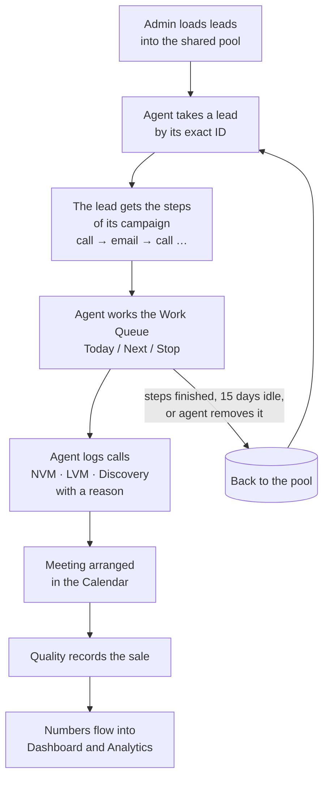
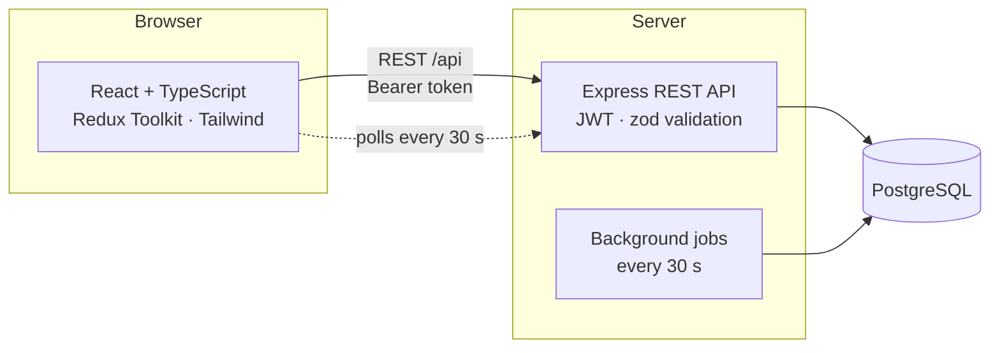

# Smart Telesales — Project Overview

**A CRM for call-center sales teams: one platform for the whole sales cycle, from the shared lead pool to a recorded
sale, with live dashboards for every level of management.**

This document explains the *idea* behind the project, how the system works end to end, and what is built today versus
what is planned. For code-level details, see the [Front End README](../frontend/README.md) and the
[Back End README](../backend/README.md).

---

## Table of contents

1. [The problem](#1-the-problem)
2. [The solution](#2-the-solution)
3. [Who uses it](#3-who-uses-it)
4. [How one lead becomes a sale](#4-how-one-lead-becomes-a-sale)
5. [What the platform offers](#5-what-the-platform-offers)
6. [System architecture](#6-system-architecture)
7. [Key design decisions](#7-key-design-decisions)
8. [Business rules](#8-business-rules)
9. [Data](#9-data)
10. [Built today vs planned](#10-built-today-vs-planned)
11. [How success is measured](#11-how-success-is-measured)
12. [Known gaps](#12-known-gaps)
13. [Documentation index](#13-documentation-index)

---

## 1. The problem

Telesales organisations (call centers selling by phone) struggle with five things:

1. **Scattered tools.** An agent moves all day between a leads spreadsheet, a calendar, a call log, e-mail and the
   manager's tracking sheets. Data goes missing and follow-ups are forgotten.
2. **Numbers without reasons.** Traditional CRMs show *how many* calls and sales happened, but not *why* customers
   said no: price, timing, a weak call script, or the wrong campaign.
3. **Money spent on leads of unknown quality.** Companies buy leads from many sources without knowing which ones
   answer the phone or convert.
4. **Unused notes.** Agents write notes after every call, but the notes sit in a database and nobody learns from them.
5. **Decisions by gut feeling.** Managers distribute leads and choose campaigns by instinct instead of data.

## 2. The solution

Smart Telesales puts the **whole sales cycle in one place**: creating leads, putting them in an agent's daily work
list, following the planned contact steps of a campaign, logging calls, booking meetings, assigning tasks, handling
escalations, recording sales, quality review, and analytics.

Each person sees only what their role needs, and each manager sees their people's progress **without asking for a
report**.

The original idea has three layers:

| Layer | Purpose | Status |
|---|---|---|
| **1. Operations** | Leads, campaigns, calls, meetings, tasks, escalations, sales | **Built** |
| **2. Analytics** | Dashboards, funnel, answer and reach rates, best calling hours | **Built** |
| **3. AI engine** | Comment analysis (NLP), lead scoring, RAG + LLM assistant, speech-to-text | **Planned** |

---

## 3. Who uses it

Five roles, each with its own screens and its own slice of the data.

| Role | Main job | Typical day in the app |
|---|---|---|
| **Admin** | Sets up the company | Loads leads into the pool, builds campaigns, creates users, moves agents between teams, assigns managers and Quality |
| **Operation Manager (OM)** | Runs one line of business (LOB: `REG` or `DJ`) | Opens the dashboard to see every team under them, checks analytics, sends updates and tasks |
| **Team Leader (TL)** | Leads one team of agents | Watches each agent's calls, emails, meetings and sales against the daily target; reassigns leads; sends updates |
| **Agent** | Calls the leads | Takes leads from the pool, works the daily **Work Queue**, logs calls, arranges meetings |
| **Quality** | Reviews and coaches | Records sales, follows a group of agents, sends them tips |

**Visibility rule (enforced by the server):** Admin sees everyone; an Agent sees only themselves; a Team Leader sees
their team; an Operation Manager sees all the teams they manage; Quality sees the agents they follow.

---

## 4. How one lead becomes a sale

Step by step:

1. **Load.** Admin adds leads to the pool one by one, or pastes/imports a list, and links each to a **campaign**.
2. **Take.** An agent takes a lead by typing its exact ID. The server locks the lead so two agents can never get the
   same one.
3. **Plan.** The lead receives the campaign's ordered **touch points** (a call or an email, each with a day offset).
4. **Work.** The agent's **Work Queue** groups leads by campaign, then *Today* (due or overdue), *Next* (later) and
   *Stop*, then by step. The agent completes, skips or restores steps.
5. **Log.** Every call is logged as **NVM** (no answer), **LVM** (answered but not the right person, or voicemail) or
   **Discovery** (reached the right person), with an optional outcome reason such as *interested*, *price*, *timing*
   or *wrong contact*.
6. **Meet.** Meetings are booked in the Calendar. A meeting needs a written outcome when completed.
7. **Sell.** Quality records the sale. It counts toward the agent, team and OM monthly targets.
8. **Recycle.** When all steps are done, after **15 days without progress**, or when the agent removes it, the lead
   returns to the pool. The previous agent may retake it at once; any other agent must wait 15 days.

---

## 5. What the platform offers

### Operations

- **Lead pool** with single add, paste and import (up to 1000 rows), duplicate checks and preview before saving.
- **Campaigns** with up to 20 touch points and gaps up to 90 days.
- **Work Queue**, call logging, skip/restore, stop/resume, searchable pickers.
- **Calendar** with meeting reminders 15 minutes before.
- **Tasks, Team Updates, Tips, Escalations** to communicate between roles, with acknowledgements and menu badges.
- **Notifications** for returned leads, meetings and assignments.

### Analytics and dashboards

- **Dashboards by role:** a Team Leader sees each agent's calls, emails, meetings and sales against the daily target;
  an Operation Manager sees every team.
- **Funnel:** leads → contacted → reached → meetings → sold.
- **Call results:** answer rate, reach rate, calls per lead, reach-to-sale.
- **Best time to call:** reach rate by hour.
- **By campaign and by agent**, for a day, week, month or custom range.
- **Call reasons:** the share of each outcome reason agents selected.
- **Data-quality warnings:** for example, calls logged without a reason, or leads with no phone number, so managers
  know when numbers are unreliable.

---

## 6. System architecture

| Part | Technology | Role |
|---|---|---|
| **Front end** | React 18, TypeScript, Vite, Redux Toolkit, Tailwind CSS | Role-based screens; keeps a copy of server data |
| **Back end** | Node.js, Express, zod, JWT, bcrypt | Business rules, permissions, validation |
| **Database** | PostgreSQL (hosted on Neon) | Source of truth: 17 tables |
| **Jobs** | Timer inside the server, guarded by a PostgreSQL advisory lock | 15-day rule, workflow completion, reminders, clean-up |

---

## 7. Key design decisions

| Decision | Why |
|---|---|
| **The server is the source of truth.** The browser stores only login tokens | No data drift between screens and database; refreshing never loses work |
| **Permissions live on the server.** The UI hides pages, but every response is filtered by who may see whom | The UI cannot be used to read forbidden data |
| **Feature-based folders** on the front end (`types / api / thunks / slice / UI`) and `routes / service` per module on the back end | Business logic, state and UI stay separate, so a feature can change without breaking others |
| **Row locks and transactions** when taking leads | Two agents can never take the same lead |
| **Idempotency keys** on logging a call and recording a sale | A double click never creates a duplicate |
| **Short access tokens (15 min) and rotating refresh tokens (30 days)** | A stolen token has a short life and cannot be reused after the real user refreshes |
| **Rules run as scheduled jobs on the server** | Lead expiry and reminders happen even when nobody has the app open |
| **All dates in Africa/Cairo time, week starts on Saturday** | Daily targets and "today" mean the same thing for everyone |
| **Polling every 30 seconds** instead of WebSockets | Simple and reliable; the data changes slowly enough that live push is not needed |

---

## 8. Business rules

| Rule | Value |
|---|---|
| Lead with no progress returns to the pool | after **15 days** |
| Another agent may retake a released lead | after **15 days** (the previous agent: immediately) |
| An arranged meeting keeps a lead alive | until the meeting is over |
| Meeting reminder | **15 minutes** before |
| Leads an agent can take in one request | up to **100** |
| Touch points per campaign / maximum gap | **20** / **90 days** |
| Import or paste size | up to **1000** rows in the UI |
| Lines of business | `REG`, `DJ` |
| Monthly sales target | set by the server (default 10 per agent); a Team Leader's target is agents × per-agent target and an OM's is the sum of teams |
| Daily call target | 1–500, default 90 |
| Password | at least 8 characters |
| Lead category by best call | **Discovery > LVM > NVM**; no calls = *New* |
| Who deletes leads | **Admin only** |
| Who records and deletes sales | **Quality** |
| Who creates meetings | Agent, TL, OM, Quality (only the creator changes its status) |

---

## 9. Data

- **Source of the idea's data:** the project was designed around realistic requirements and about **10,000 leads**
  from a sales environment linked to *Amazon Business – USA*, including campaigns, codes, call interactions, text notes
  and positive and negative sales outcomes. Personal identifiers such as names and phone numbers were anonymised.
- **This repository contains no customer data.** It holds only the code and the database schema.
- **Database:** 17 tables in five groups: people and sessions, sales work (campaigns, leads, assignments, call logs,
  history, meetings, sales), communication (updates, tasks, tips, escalations, notifications), and infrastructure
  (idempotency keys). Every important lead event is written to a history table, giving each lead an audit trail.

---

## 10. Built today vs planned

| Area | Status |
|---|---|
| Five roles, login, token refresh, role-based visibility | **Built** |
| Lead pool, campaigns, work queue, calls, meetings, sales | **Built** |
| Tasks, updates, tips, escalations, notifications | **Built** |
| Dashboards and analytics (funnel, rates, best hours, reasons, data quality) | **Built** |
| Scheduled jobs (15-day rule, reminders) | **Built** |
| Structured call reasons chosen by the agent | **Built** (the agent picks the reason; no automatic text analysis yet) |
| **NLP** on call comments: classify rejection reasons and objections | Planned |
| **Lead scoring:** probability to answer and to buy, priority order | Planned |
| **RAG + LLM assistant:** next-step and call-script suggestions with reasons | Planned |
| **Speech-to-text** for call recordings and voice notes | Planned |
| E-mail sending from the app (today the agent copies the text or opens the mail app) | Planned |

**Technology choices that changed from the first proposal:** the front end uses plain React with Vite (the proposal
mentioned Next.js), and the charts are drawn with Tailwind rather than Recharts.

---

## 11. How success is measured

The plan is to compare performance before and after adoption, instead of assuming improvement:

1. **Answer and conversion rates** before and after, once lead scoring directs agents to the best leads.
2. **Text-analysis accuracy,** measured with precision and recall against a hand-labelled sample.
3. **Return on investment,** by shifting effort and spend toward the campaigns and leads that actually sell.
4. **Time saved and data accuracy,** from fewer tools and fewer lost follow-ups.

These measurements need real usage data and are not part of the current code.

---

## 12. Known gaps

Notes for anyone reading the code next to the older documents:

- **E-mail:** the API reference lists e-mail endpoints and an automatic send job. The code does not include them.
- **Deleting a lead:** the API reference describes an agent-level delete and a `HAS_SALE` rule. In the code only Admin
  deletes, and the lead's sales are deleted with it.
- **"Needs reassignment" list:** expired leads go straight back to the pool, so this list in the Team Leader
  dashboard stays empty.
- **Base path:** the code serves `/api`; the API reference and the front end default use `/api`. Set
  `VITE_API_URL` accordingly.
- **Seed script:** `scripts/seed.js` calls functions that were renamed and needs a small fix.

---

## 13. Documentation index

| Document | What it covers |
|---|---|
| [Project README](../README.md) | Quick start and links |
| [Front End README](../frontend/README.md) | Architecture, roles and pages, how to add a feature |
| [Back End README](../backend/README.md) | API, authentication, lead lifecycle, jobs, database |
| [Front end documentation](./frontend-documentation.md) | Every file and function of the client |
| [Back end documentation](./backend-documentation.md) | Every file and function of the server |
| [API reference](./smart-telesales-apis.html) | Request and response examples |
